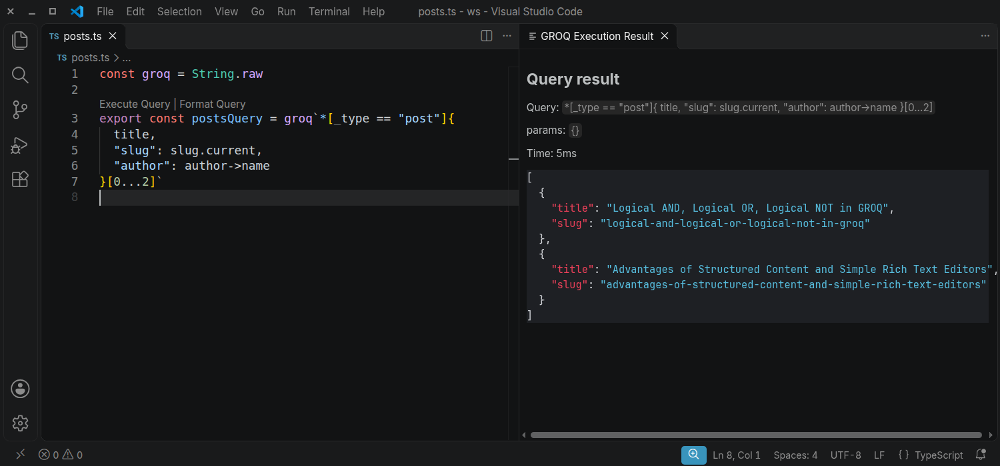
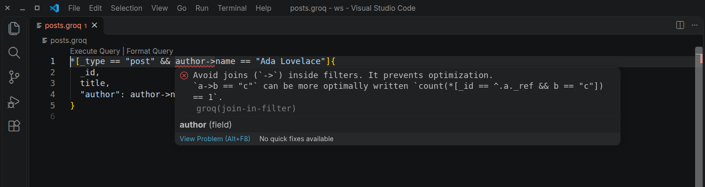

# Sanity.io for VS Code and Cursor

Write, check and run [GROQ](https://www.sanity.io/docs/groq) queries without leaving your editor. This extension adds GROQ support to [Visual Studio Code](https://code.visualstudio.com/) and [Cursor](https://cursor.com/) for [Sanity](https://www.sanity.io/) projects.

- **Run queries from your editor.** Click **Execute Query** above any GROQ query and see the result as JSON next to your code.
- **Catch mistakes as you type.** Syntax errors and common performance problems are flagged in the editor.
- **Autocomplete GROQ.** Get suggestions for functions, system fields and, with your schema, your document types and fields.
- **Format queries.** Tidy a query with one click, or a whole `.groq` file with **Format Document**.
- **Syntax highlighting** for GROQ in `.groq` files, JavaScript, TypeScript and Astro template literals, and Markdown. Astro files need the [Astro extension](https://marketplace.visualstudio.com/items?itemName=astro-build.astro-vscode).



## Requirements

- Visual Studio Code 1.107 or newer, or a recent version of Cursor.
- To execute queries: a `sanity.cli.ts` file in your workspace, with the `projectId` and `dataset` of the project to query.

## Execute queries

Open a `.groq` file, or a JavaScript, TypeScript or Astro file with a GROQ query, and click **Execute Query** above the query. The result opens in a **GROQ Execution Result** panel beside the editor, together with how long the query took. In a `.groq` file you can also run **Execute GROQ query** from the command palette, or press `Ctrl+Shift+G` in the editor.

- **Project and dataset.** They are read from `sanity.cli.ts` in your workspace. If the workspace has several, you are asked which one to use. If the file sets an API `token`, it is used to query private datasets.
- **API version.** Queries use the API version in `sanity.apiVersion`, `v2025-02-19` by default. Set a date such as `v2021-03-25`, or `v1` or `vX` (experimental). Newer GROQ features, such as `pt::text()`, need a recent version. An invalid value is ignored with a warning, and the default is used.
- **Query parameters.** If the query uses variables such as `$slug`, you are asked for a JSON file with the values. A file with the same name as the current file and a `.json` extension is suggested when it exists.
- **Fragments.** `${}` interpolations are filled in before the query runs, from fragments in the same file or imported from other files, `tsconfig.json` `paths`, workspace packages in `node_modules`, and `.groq` files. A `${}` the extension cannot follow, such as a function call, is sent as written.
- **Copy instead.** Click **Copy Query** next to **Execute Query** to copy the query to the clipboard, with the same `${}` fragments filled in that Execute Query uses. In a `.groq` file, **Copy GROQ query** in the command palette copies the selection, or the whole file when nothing is selected.

`@sanity/astro` sets the project in `astro.config.mjs`, which this extension does not read. Add a `sanity.cli.ts` next to it:

```ts
import {defineCliConfig} from 'sanity/cli'

export default defineCliConfig({
  api: {projectId: '<your-project-id>', dataset: 'production'},
})
```

## GROQ language support

The extension checks and completes GROQ in `.groq` files and in `groq` template literals in JavaScript and TypeScript.



- **Diagnostics** for syntax errors and [lint rules](https://www.npmjs.com/package/@sanity-labs/groq-lint), such as joins inside filters or `count()` on correlated subqueries.
- **Fragments.** Queries with `${}` interpolations are checked with their fragments filled in, as Execute Query runs them. Editing an open fragment re-checks the queries that use it. Queries with a `${}` the extension cannot follow are not checked.
- **Completion and hover** for system fields and functions. With a schema, they also cover your document types and fields.
- **Snippets** for common queries, for example `type`, `deref`, `orda` and `slice` in `.groq` files, and `groq` and `groqslug` in JavaScript and TypeScript.

### Use your schema

For completion and hover that know your document types, extract your schema:

```sh
npx sanity schema extract
```

The extension picks up `schema.json`, `sanity.schema.json`, `.sanity/schema.json` or `studio/schema.json` in the first workspace folder. For a schema stored elsewhere, set `groq.schemaPath`.

### Use your groq-content-mapper settings

If your project uses [groq-content-mapper](https://github.com/sanity-labs/groq-content-mapper), the extension reads its settings from the `tsconfig.json` nearest each file:

- **Schema.** When `groq.schemaPath` is not set and none of the files above exists, the extension uses the schema the mapper is configured with: its `schema` option, or the `schemas` entry whose folder holds the file. A project set up for the mapper needs no setting.
- **Custom functions.** In `.groq` files, queries that call the shared [custom GROQ functions](https://www.sanity.io/docs/content-lake/custom-groq-functions) in the mapper's `functions` option are checked and hovered with those functions' definitions, as the mapper adds them, instead of failing to parse.

### Format queries

- In `.groq` files, use **Format Document**.
- In JavaScript, TypeScript and Astro files, click **Format Query** above a query to format just that one. It works for `groq` and `defineQuery` template literals, but not for queries that contain `${}` interpolations or backslash escapes.
- To format every GROQ query in a JavaScript or TypeScript file, run **GROQ: Format GROQ Queries** from the command palette. Your usual formatter keeps handling the rest of the file.
- **Format Document** and **GROQ: Format GROQ Queries** indent with the editor's tab size, and with tabs when the editor uses tabs.

#### Suggested parameter values

When a parameter is compared to a field whose values are known from your schema, the prompt for it lists those values instead of an empty input. `*[_type == $type]` suggests the document type names, and `*[_type == "post" && status == $status]` suggests the literals of `status` when it is an enum or a list of string options. Any other text can still be typed. Parameters compared to open fields (a plain `string`, a function result, ...), or used anywhere else in the query, get the plain input.

The schema is the one your project already points at: the `schema` (or the matching `schemas` entry for the file, by folder) in the `@sanity-labs/groq-content-mapper` options of the nearest `tsconfig.json` to the file you run, `extends` included. Without a mapper config it is the file `sanity schema extract` writes for `sanity.cli.ts` (`schemaExtraction.path`, `./schema.json` by default).

### GROQ in TypeScript hovers

When TypeScript shows the type of a GROQ query, for example for a `defineQuery` result, hovering it also shows the query formatted over multiple lines and highlighted as GROQ. Turn this off with `sanity.formatGroqInHover`.

### Go to Definition for `.groq` imports

Go to Definition, and Cmd/Ctrl+click, on a `.groq` import such as `import query from '#queries/slugPage.groq'` opens the file. Relative paths and the `paths` and `baseUrl` of the nearest `tsconfig.json` or `jsconfig.json` are followed. A `tsconfig.json` that gets its `paths` from `extends` is not read.

## Syntax highlighting

GROQ is highlighted in:

- Files with the `.groq` extension
- Fenced code blocks in Markdown tagged `groq`
- Template literals tagged with `groq`
- Queries wrapped in `defineQuery`
- Template literals that start with a `/* groq */` or `// groq` comment

## Settings

Find these in **Settings** by searching for `sanity` or `groq`.

| Setting                         | Default       | Description                                                                          |
| ------------------------------- | ------------- | ------------------------------------------------------------------------------------ |
| `sanity.useCodelens`            | `true`        | Show **Execute Query** and **Format Query** above queries.                           |
| `sanity.useCDN`                 | `false`       | Use the Sanity API CDN when executing queries.                                       |
| `sanity.apiVersion`             | `v2025-02-19` | API version used when executing queries: a date, `v1` or `vX`.                       |
| `sanity.openJSONFile`           | `false`       | Open query results as an editable JSON file instead of the result panel.             |
| `sanity.formatGroqInHover`      | `true`        | Show GROQ queries in TypeScript hovers formatted and highlighted.                    |
| `sanity.formatGroqInHoverWidth` | `40`          | Column width that queries in hovers are wrapped to.                                  |
| `groq.enable`                   | `true`        | Turn on diagnostics, completion, hover and formatting.                               |
| `groq.schemaPath`               | `""`          | Schema file from `npx sanity schema extract`, absolute or relative to the workspace. |
| `groq.maxDiagnostics`           | `100`         | Maximum number of diagnostics per file.                                              |
| `groq.enableFormatting`         | `true`        | Turn on GROQ formatting.                                                             |

If GROQ support stops responding, run **GROQ: Restart Language Server** from the command palette. **GROQ: Show Language Server Output** shows its log.

## Feedback

Found a bug or have an idea? [Open an issue](https://github.com/sanity-io/vscode-sanity/issues). To work on the extension yourself, see [CONTRIBUTING.md](https://github.com/sanity-io/vscode-sanity/blob/main/CONTRIBUTING.md).

Using Cursor? The extension is also available on [Open VSX](https://open-vsx.org/extension/sanity-io/vscode-sanity).
