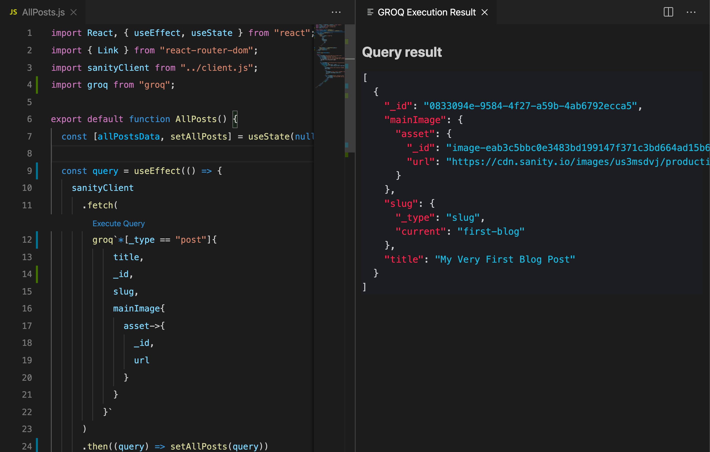

# vscode-sanity

Extension for [Visual Studio Code](https://code.visualstudio.com/) / [Cursor](https://cursor.com/) that makes developing applications for [Sanity.io](https://www.sanity.io/) that much more awesome.

## Features

### GROQ syntax highlighting

Syntax highlighting for the GROQ query language is available in the following situations:

- Files with the `.groq` extension
- Fenced code blocks in Markdown with the `groq` tag
- Tagged template literals with the `groq` tag
- Queries using the `defineQuery` method
- Template literals prefixed with the `/* groq */` comment
- Template literals starting with a `// groq` comment

### Execute GROQ-queries

When GROQ-queries are detected, the extension will allow you to run the query and displays the result as JSON in a separate tab.

The project ID and dataset used is determined by finding `sanity.cli.ts` in the workspace. If multiple files are found, the extension will prompt you to select one.

If the GROQ file/query has any variables, then extension asks for a relative filename of a JSON-file containing an object of key-value mappings. It autofills the param filename based on the current file with a `.json` extension, if it exists.



### GROQ in TypeScript hovers

TypeScript prints the type of a GROQ query (for example a `.groq` import typed as `/* groq */` template literal) as a single double-quoted string with `\n` escapes. When you hover such a type, or a value of that type, the extension adds a second section to the hover with the query formatted onto real lines and syntax highlighted as GROQ. VS Code cannot hide the language server's own section, so both are shown.

Detection works on the hover text itself: a string or template literal in a code block that parses as GROQ and references the dataset (`*[...]`) is picked up, as is a fenced `groq` block from the query's documentation (groq-content-mapper adds one with the query as authored). The mapper's prettify option is not needed: the extension formats the query with [groq-format](https://github.com/atombender/groq-format) (through [`@sanity-labs/groq-wasm`](https://github.com/sanity-labs/sanity-lint/tree/main/packages/groq-wasm)), wrapped to 80 columns by default (`sanity.formatGroqInHoverWidth`). The whole string is formatted together, including prepended custom function definitions (`fn image::asset($asset) = ...;`) and comments, which are kept. A query that cannot be parsed is shown as it is.

TypeScript 7 cuts long types off after about 5,000 characters, in the middle of the query. If the hover also has the query's documentation block, that full copy is formatted instead. Otherwise the extension does not format half a query: it says the hover was truncated, and the full query is in the `.groq` file.

Turn the whole feature off with `sanity.formatGroqInHover`.

### GROQ linting, completion and formatting

The extension runs the GROQ language server from [`@sanity-labs/groq-lsp`](https://www.npmjs.com/package/@sanity-labs/groq-lsp) on `.groq` files and on `groq` tagged template literals in JavaScript and TypeScript files:

- **Diagnostics**: syntax errors, and [groq-lint](https://www.npmjs.com/package/@sanity-labs/groq-lint) rules such as joins inside filters or `count()` on correlated subqueries.
- **Completion** of system fields, functions and, when a schema is available, your document types and fields.
- **Hover** information for fields and functions inside a query.
- **Formatting**: `Format Document` formats `.groq` files. In JavaScript and TypeScript files, `Format Document` is left to your usual formatter; run **GROQ: Format GROQ Queries** to format the `groq` template literals in the file. To format one query, click the **Format Query** code lens above it. It works on `groq` and `defineQuery` template literals and `.groq` files, without the language server. It is not shown for queries with `${}` interpolations or backslash escapes.

For schema-aware completion and hovers, extract your schema with `npx sanity schema extract`. The server looks for `schema.json`, `sanity.schema.json`, `.sanity/schema.json` or `studio/schema.json` in the first workspace folder, or uses `groq.schemaPath`.

| Setting                 | Default | Description                                                                   |
| ----------------------- | ------- | ----------------------------------------------------------------------------- |
| `groq.enable`           | `true`  | Run the language server.                                                      |
| `groq.schemaPath`       | `""`    | Schema file, absolute or relative to the first workspace folder.              |
| `groq.maxDiagnostics`   | `100`   | Maximum number of diagnostics per file.                                       |
| `groq.enableFormatting` | `true`  | Enable GROQ formatting.                                                       |
| `groq.trace.server`     | `"off"` | Log the communication with the server to the **GROQ Language Server** output. |

**GROQ: Restart Language Server** and **GROQ: Show Language Server Output** are in the command palette.

### GROQ snippets

Snippets for common queries are available in `.groq` files (for example `type`, `typep`, `deref`, `orda`, `slice`) and in JavaScript and TypeScript files (for example `groq`, `groqp`, `groqslug`, `groqlist`, `constquery`).

## Usage

Install the extension for [VSCode](https://marketplace.visualstudio.com/items?itemName=sanity-io.vscode-sanity) or [Cursor](https://open-vsx.org/extension/sanity-io/vscode-sanity) by searching for `sanity`. This extension adds syntax highlighting for GROQ-files and `groq` tags.

## Development

1.  Clone the repository - https://github.com/sanity-io/vscode-sanity
2.  `pnpm install`
3.  Open it in VSCode
4.  Go to the debugging section and run the launch program "Extension"
5.  This will open another VSCode instance with extension enabled
6.  Open a file that should be syntax highlighted
7.  Make changes to the extension code, then press (`Ctrl+R` or `Cmd+R` on Mac) in the syntax highlighted file to test the changes

> We follow semantic versioning. Whether a change is a patch, minor or major release, and what the changelog says about it, comes from the changeset added with the change (see [Publishing](#publishing)).

Run `pnpm test` for the unit tests. `pnpm run test:integration` downloads VS Code and checks the hover end to end against the built-in TypeScript extension. `pnpm run test:integration:tsgo` does the same with the TypeScript 7 extension (`TypeScriptTeam.native-preview`, downloaded from the Marketplace) running TypeScript 7.1 and `@sanity-labs/groq-content-mapper` on the `.groq` files in `fixtures/hover-project`. On Linux without a display, run either with `xvfb-run -a`.

If you want to build/inspect the vsix file, you can do `pnpm run package`. It can then be "installed from location" in either Cursor or VS Code.

## Publishing

Releases are managed with [Changesets](https://github.com/changesets/changesets). Add a changeset to any PR that should be released, describing the change for the changelog:

```sh
pnpm changeset
```

When changesets land on `main`, the release workflow opens (or updates) a "Version Packages" PR that bumps the version in `package.json` and writes `CHANGELOG.md`. Merging that PR packages the vsix, publishes it to the [Visual Studio Marketplace](https://marketplace.visualstudio.com/items?itemName=sanity-io.vscode-sanity) and the [Open VSX registry](https://open-vsx.org/extension/sanity-io/vscode-sanity), and then tags the version and creates the GitHub release. If a publish fails nothing is tagged, so re-running the workflow retries it.

Run `pnpm changeset status` to see what the next release will contain.

> ⚠️ Publishing only works in CI: the workflow authenticates to both registries with GitHub OIDC trusted publishing, so there are no access tokens to publish with locally.

## License

MIT
